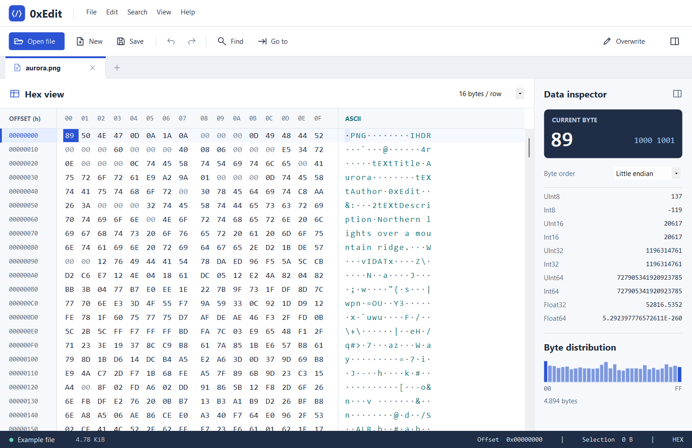
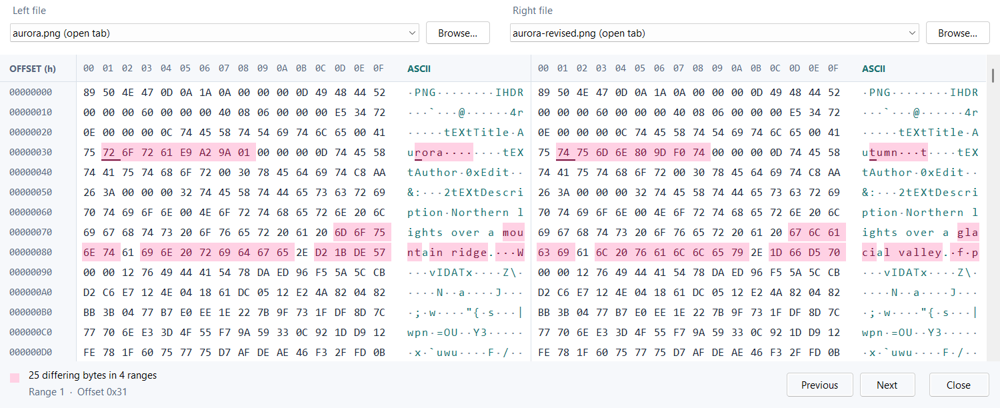

# 0xEdit

0xEdit is a C# hex editor for Windows. Open a binary file, edit its hex or ASCII representation, and inspect the numeric value at any offset. The standalone executable uses Windows Forms and .NET Framework 4.8.



## Build and launch

From a Windows PowerShell or PowerShell terminal in the project directory, run

```powershell
.\build.ps1
.\bin\Release\0xEdit.exe
```

The script uses the C# compiler included with .NET Framework. You can also open `0xEdit.csproj` in Visual Studio with the .NET Framework 4.8 targeting pack installed.

Launching without arguments starts with an empty workspace. Open a file with **Ctrl+O**, drag files into the window, or pass one or more paths on the command line. To explore the bundled PNG, choose **File → Open example**.

```powershell
.\bin\Release\0xEdit.exe .\assets\aurora.png .\assets\0xEdit.ico
```

## Editing

- Click a byte and type two hexadecimal digits. The first digit changes the high nibble immediately. Undo restores the entire byte after you finish the pair.
- Press **Tab** to switch between hex and ASCII input. **Insert** toggles insert and overwrite modes. Typing at the end of a file appends bytes.
- Drag or use **Shift** with the arrow keys to select bytes. Typing or pasting over a selection replaces the whole selection. **Edit → Select block** accepts a start offset and length in hexadecimal or decimal.
- Copy from the hex pane to get space-separated hex text, or from the ASCII pane to get text. Copies also carry the original bytes for lossless pasting between 0xEdit windows. Clipboard copies support up to 16 MiB. **File → Save selection as** streams larger selections directly to a file.
- **Search → Find** (**Ctrl+F**) accepts hex bytes or case-sensitive text. Choose **ASCII**, **Windows-1252**, **UTF-8**, **UTF-16 LE**, **UTF-16 BE**, **UTF-32 LE**, or **UTF-32 BE** from the search format list. Searches match the exact encoded bytes at any offset, wrap in either direction, and include unsaved edits.
- **Search → Replace** (**Ctrl+H**) uses the selected format for both fields. **Replace** changes the first match at or after the start of the selection or caret, wrapping if needed. **Replace all** changes every non-overlapping match in the active file in one undo step. A replacement can have a different byte length. Leave **Replace with** empty to delete matches. Press **Esc** to cancel a scan in progress.
- The data inspector interprets bytes starting at the caret or the first selected byte. Switch the byte order to inspect integers and IEEE 754 floating-point values. The distribution chart groups the first 64 KiB into 32 buckets.
- **View → Calculate SHA-256** hashes the current selection, or the whole document when the selection is empty. The result includes unsaved edits.

## Compare files

Choose **File → Compare files** (**Ctrl+Shift+C**). Select an open tab on each side or use **Browse** to choose a file from disk. Open tabs include unsaved edits, so you can compare an edited tab with its saved file.

The read-only view shows both files at the same offsets. Pink cells mark differences in both hex and ASCII. A `--` on the shorter side marks a missing byte. An insertion shifts the subsequent offset comparisons. Use **F7** and **Shift+F7** to jump between contiguous ranges of differences.



## Keyboard shortcuts

| Action | Shortcut |
| --- | --- |
| New, open, save | Ctrl+N, Ctrl+O, Ctrl+S |
| Save as | Ctrl+Shift+S |
| Undo, redo | Ctrl+Z, Ctrl+Y |
| Cut, copy, paste | Ctrl+X, Ctrl+C, Ctrl+V |
| Select all, select block | Ctrl+A, Ctrl+E |
| Find, next match, previous match | Ctrl+F, F3, Shift+F3 |
| Replace | Ctrl+H |
| Compare files | Ctrl+Shift+C |
| Next or previous difference (comparison window) | F7, Shift+F7 |
| Go to offset | Ctrl+G |
| Beginning or end of file | Ctrl+Home, Ctrl+End |
| Next or previous file | Ctrl+Tab, Ctrl+Shift+Tab |
| Close file | Ctrl+W |

## Large files and saving

0xEdit uses 64-bit offsets. A piece table references ranges in the original file and stores newly typed or pasted bytes in memory. Undo and redo reuse those ranges. The hex grid reads the visible rows, and searches scan in chunks.

Saving writes the edited document to a temporary file in the destination directory and replaces the destination after flushing the new contents. Allow enough disk space for the full output. Undo history remains available after saving. Closing a modified tab prompts you to save.

## Tests

```powershell
.\build.ps1 -Test
.\bin\Release\0xEdit.Tests.exe --ui
```

The first command builds the release and checks randomized edits, undo history, save failures, selection export, forward and reverse searches, numeric conversion, and native clipboard data. The large-file test uses a sparse temporary file to exercise offsets above 4 GiB on NTFS. The second command exercises the Windows Forms controls in an off-screen window.

## License

The source and bundled example are available under the [MIT License](LICENSE).
